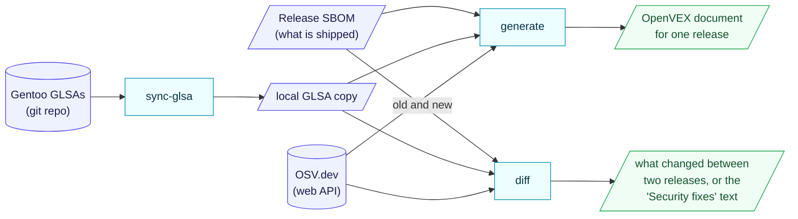
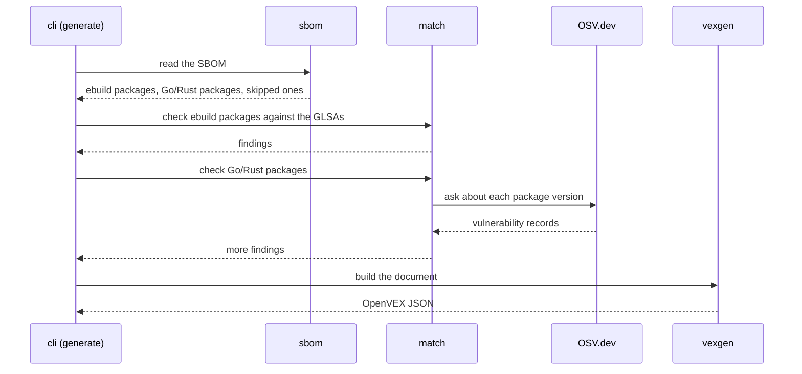
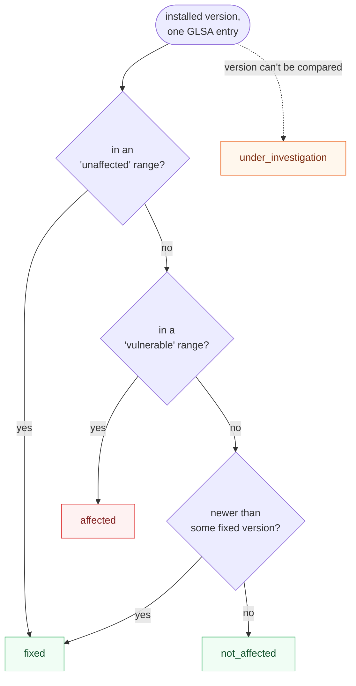
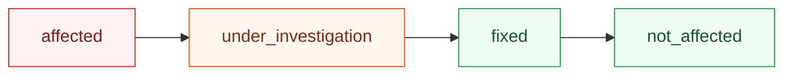
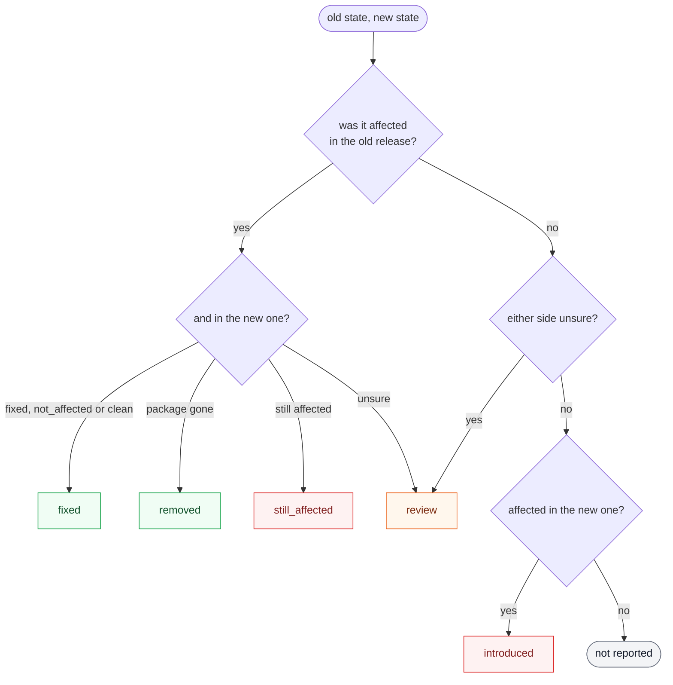

# How flatcar-vex works

This page is for an engineer opening this repository for the first time. It explains what
the tool is for, what it does when, and why it does it that way. For the project history
and roadmap, see [`current-state.md`](./current-state.md) and [`plan.md`](./plan.md).

## The problem

Every Flatcar release ships an SBOM: a JSON list of every package in the image, with its
exact version. Users feed it to vulnerability scanners, and the scanners answer with long
lists of CVEs, many of which Flatcar has already fixed or never shipped in a vulnerable
version. Nobody can tell which, because Flatcar publishes no machine-readable answer.
Today the only answer is the "Security fixes" section of the release notes, which people
type by hand.

[OpenVEX](https://github.com/openvex/spec) is the standard format for that answer. A VEX
document holds one statement per vulnerability, saying whether this release is
`affected`, `fixed`, `not_affected` or `under_investigation`. Scanners read it and drop the
noise.

flatcar-vex produces that document for a release, and drafts the "Security fixes" section
by comparing two releases.

## What goes in and what comes out



There are three commands, run in this order.

`sync-glsa` clones or updates Gentoo's advisory repository into a local directory. It is
separate so that the other commands work offline for Gentoo data and so that two runs on
the same day see exactly the same advisories.

`generate` takes one release SBOM and writes its OpenVEX document. This is what would
run for every release.

`diff` takes the SBOMs of two releases and reports what changed between them. Its main
use is drafting the "Security fixes" section of the release notes, which is also how we
test that the tool gives the right answers: real, hand-written release notes are the
reference in `internal/cli/testdata/releases.json`.

## Where the vulnerability data comes from

Flatcar is built from Gentoo, so most of the image is Gentoo ebuild packages (OpenSSL,
curl, systemd and so on). Gentoo publishes a GLSA (Gentoo Linux Security Advisory) when a
package has a vulnerability. Each GLSA is an XML file that names the CVEs and gives version
ranges:

```xml
<package name="dev-libs/openssl" auto="yes" arch="*">
  <unaffected range="ge">3.0.13</unaffected>
  <vulnerable range="lt">3.0.13</vulnerable>
</package>
```

Flatcar's build already runs Gentoo's `glsa-check` against these files and fails if an
image is vulnerable, so they are the natural source for ebuild packages.

The image also contains about a thousand Go modules and Rust crates compiled into binaries
such as containerd and Docker. Gentoo does not write advisories for those. For them, the
tool asks [OSV.dev](https://osv.dev), a public database that answers "which
vulnerabilities affect this exact package version?". It needs network access, and
`--osv=false` turns it off.

## Ground rules

A few rules explain most of the decisions in the code.

**Only use data that is already published.** Every statement must trace back to the SBOM,
a GLSA or an OSV.dev record. The tool never guesses whether a CVE is exploitable.

**Don't let "not checked" look like "not affected".** OpenVEX makes no claim about a CVE
that a document leaves out, but readers easily take silence as "all clear". So a version the tool cannot evaluate becomes
`under_investigation` instead of disappearing, and the `tooling` field of both the VEX
document and the diff JSON records when OSV.dev was off or GLSA files failed to parse. The
diff JSON also lists packages that no source covers under `not_checked`; `generate` only
logs them (visible with `--verbose`). The changelog text carries none of this, so check
the JSON before trusting an empty changelog.

**Agree with the build.** GLSA matching follows `glsa-check`'s own logic, so the VEX
document never contradicts the check that gates Flatcar releases.

**When unsure, say so.** If two findings disagree about one CVE, the more worrying one
wins (see "Writing the VEX document" below).

## How generate works



The unit of work between the steps is a **finding**: "this vulnerability, in this
package, has this status, according to this advisory". The matchers produce findings,
and the output steps consume them without caring which source a finding came from.

### 1. Reading the SBOM

The SBOM is SPDX JSON. Each package carries a purl (package URL), and its type says which
source can check it: `pkg:ebuild/...` goes to the GLSA matcher, `pkg:golang/...` and
`pkg:cargo/...` go to OSV.dev. Everything else is skipped. The Linux kernel is
the main example; its CVEs are handled by a separate Flatcar pipeline.

A Go module whose version is `(devel)` cannot be looked up, so it is also skipped, but
remembered by name. That lets `diff` say "this module could not be checked" instead of
"this module is clean".

### 2. Checking ebuild packages against GLSAs

For every GLSA and every installed package it names, the tool decides one status. It
asks the same questions in the same order as `glsa-check`:



The third question exists because GLSAs often only say "fixed in 4.11.6 and later within
this branch". A much newer version (say 4.22) is in neither range, but it clearly contains
the fix, so it counts as `fixed`.

Versions are compared with Gentoo's rules, not semantic versioning. Gentoo versions look
like `1.2.3_p4-r1` (patch level 4, ebuild revision 1), and semver orders these
differently, so `internal/portage` is a port of Portage's own comparison.

Two complications can make the answer uncertain. First, some GLSA ranges only apply to
one *slot*, Gentoo's name for a parallel-installable branch such as Python 3.11 versus
3.12. The SBOM does not record slots, so when the slot could change the answer, the result
is `under_investigation`. Second, a few packages are versioned differently by Flatcar and
Gentoo. `ca-certificates` is one: Flatcar uses the NSS version (`3.125`), Gentoo uses a
date plus the NSS version (`20260816.3.125`). Compared directly, every Flatcar version
would look older than every fix. `internal/match/versionscheme.go` translates such
packages before comparing.

A GLSA lists several CVEs, so one GLSA match produces one finding per CVE. A GLSA without
any CVE is reported under its own ID, `GLSA-<id>`.

### 3. Checking Go and Rust packages against OSV.dev

The tool sends all package versions to OSV.dev's batch endpoint, which returns the IDs of
the vulnerabilities that affect each exact version. It then fetches each full record,
because only the full record lists the CVE aliases.

Two consequences follow. Every OSV.dev finding is `affected`, because OSV.dev only answers
for vulnerable versions. A fixed vulnerability therefore shows up as *no finding*, which
is why `diff` treats silence from OSV.dev as a fix.

OSV.dev often has several records for one vulnerability (a GitHub advisory `GHSA-...`, a
Go advisory `GO-...`, and the CVE). The tool groups records that point to each other and
reports the group under its CVE IDs. That way a CVE found by both Gentoo and OSV.dev ends
up in one VEX statement, not two.

### 4. Writing the VEX document

The findings are grouped by vulnerability ID, and each group becomes one statement about
the release as a whole. The release is identified by a purl derived from the SBOM name,
for example `pkg:generic/flatcar-container-linux@4593.2.4?channel=stable`, and the
packages involved are listed under it.

A release cannot be both fixed and affected, so when findings for one CVE disagree, the
statement takes the most severe status:



For example, if the image ships two copies of a Go module and only one is patched, the
CVE is `affected`. A real statement looks like this:

```json
{
  "vulnerability": { "name": "CVE-2001-1413" },
  "products": [{
    "@id": "pkg:generic/flatcar-container-linux@4593.2.4-a1?channel=stable",
    "subcomponents": [{ "identifiers": { "purl": "pkg:ebuild/app-arch/ncompress@5.0-r2" } }]
  }],
  "status": "fixed"
}
```

The document's `tooling` field records which sources were used, so a reader can tell a
GLSA-only document from a full one.

## How diff works

`diff` answers "what did the new release fix?". It loads and matches both SBOMs exactly
like `generate`, with one important detail: both sides are checked against the **same**
GLSA directory and the **same** OSV.dev answers. If the advisories were fetched at
different times, a new advisory would look like a change between the releases.

There is one extra step for curl. Gentoo's curl GLSAs bundle years of CVEs under a single
range, so an upgrade past that range would "fix" dozens of CVEs that earlier releases had
already fixed. curl publishes precise per-CVE advisories on OSV.dev, so `diff` rechecks
curl's GLSA findings against them. On one real release pair this cut the wrongly listed
curl CVEs from 39 to 3. It needs OSV.dev, so it is skipped with `--osv=false`.

Next, for each (vulnerability, package) pair, each side is reduced to one state: one of
the four statuses, `absent` (package not shipped), `clean` (shipped, no finding) or
`unchecked` (could not be checked). The pair of states then lands in a bucket:



"Unsure" means `under_investigation` or `unchecked`. Those go to `review` for a human,
because claiming a fix that did not happen is worse than missing one.

With `--format json` you get every bucket. With `--format changelog` you get only the
`fixed` bucket as release-notes Markdown, one line per package with its CVEs. Go's
`stdlib` and `toolchain` are merged into one "Go" line, and a CVE is held back from that
line while either of them is still affected or unchecked.

## Where things live

| Package | Role |
|---|---|
| `internal/cli` | The commands. The only package that knows the whole flow, so start reading here. |
| `internal/sbom` | Reads the SBOM and sorts packages by which source can check them. |
| `internal/glsa`, `internal/glsasync` | Parse GLSA XML files; clone or update the GLSA repository. |
| `internal/osv` | Small OSV.dev client with batching, paging and retries. |
| `internal/portage` | Gentoo version comparison. |
| `internal/match` | Turns packages and advisories into findings. All matching decisions live here. |
| `internal/vexgen` | Turns findings into an OpenVEX document, using the official `go-vex` library. |
| `internal/diff` | Compares two releases and renders the changelog. |

## Known limits

The tool only knows what its sources know. A CVE without a GLSA or OSV.dev record is
invisible to it, and so is any package the SBOM does not list. Kernel CVEs are out of
scope on purpose, since another Flatcar pipeline covers them. The tool does not judge
whether a vulnerable function is actually reachable; `not_affected` here only ever means
"the installed version is outside every vulnerable range".
