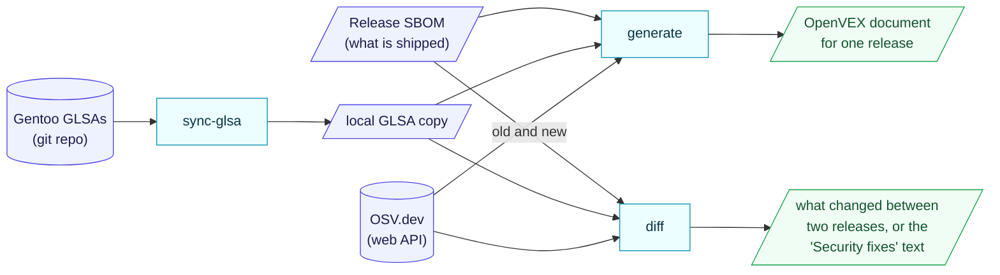

# How flatcar-vex works

Every Flatcar release ships an SBOM listing each package in the image with its exact
version. Scanners turn it into long lists of CVEs, many of which Flatcar already fixed or
never shipped in a vulnerable version. [OpenVEX](https://github.com/openvex/spec) is the
standard way to say which: one statement per vulnerability, `affected`, `fixed`,
`not_affected` or `under_investigation`. flatcar-vex writes that document for a release,
and drafts the "Security fixes" section of the release notes by comparing two releases.

Each directory here has a short README with its intent and logic, so you can follow the
tool without reading the code. For project history and roadmap see
[`docs/current-state.md`](../docs/current-state.md) and [`docs/plan.md`](../docs/plan.md).

## Data flow

Flatcar is built from Gentoo, so most of the image is Gentoo ebuilds, which Gentoo's
advisories (GLSAs) cover. The roughly thousand Go modules and Rust crates compiled into
binaries such as containerd are not covered by GLSAs, so the tool asks OSV.dev about them.

## Packages

| Package | Role |
|---|---|
| [`cli`](./cli) | The commands. The only package that knows the whole flow, so start here. |
| [`sbom`](./sbom) | Reads an SBOM and sorts its packages by ecosystem. |
| [`vuln`](./vuln) | The shared vocabulary: a `Finding` and its VEX `Status`. |
| [`source/glsa`](./source/glsa) | Syncs, parses and matches Gentoo's GLSAs. |
| [`source/osv`](./source/osv) | Queries and matches OSV.dev; rechecks curl. |
| [`portage`](./portage) | Gentoo version comparison. |
| [`vexgen`](./vexgen) | Turns findings into an OpenVEX document. |
| [`diff`](./diff) | Compares two releases and renders the changelog. |

Dependencies point one way: `cli` uses everything; sources produce `vuln.Finding`s from
`sbom.Package`s; `vexgen` and `diff` consume findings and never know which source made
them. Adding a source means adding a package under `source/` that returns findings.

## Ground rules

Only use published data. Every statement traces back to the SBOM, a GLSA or an OSV.dev
record; the tool never guesses whether a CVE is exploitable.

Don't let "not checked" look like "not affected". A version that can't be evaluated
becomes `under_investigation` instead of disappearing, and the `tooling` field of the VEX
document and the diff JSON records when OSV.dev was off or GLSA files failed to parse.
The diff JSON also lists packages no source covers under `not_checked`; `generate` only
logs them (visible with `--verbose`).

Agree with the build. GLSA matching follows Gentoo's `glsa-check`, which already gates
Flatcar releases, so the two never contradict each other.

When unsure, say so. If findings for one CVE disagree, the more worrying one wins.

## Known limits

A CVE without a GLSA or OSV.dev record is invisible, and so is a package the SBOM does not
list. Kernel CVEs are out of scope on purpose; another Flatcar pipeline covers them. The
tool does not judge reachability: `not_affected` only means "the installed version is
outside every vulnerable range".
