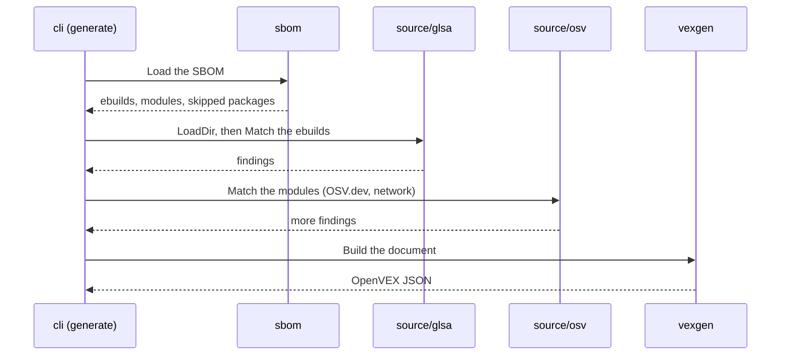

# cli

The commands, and the only package that ties the others together.

`sync-glsa` clones or updates Gentoo's GLSA repository into a local directory
(`glsa.Sync`). It is a separate step so that `generate` and `diff` work offline for Gentoo
data and two runs on the same day see exactly the same advisories.

`generate` answers "which known vulnerabilities affect this release?" for one SBOM:

`diff` answers "what did the newer release fix?". It loads and matches two SBOMs the same
way, against the same GLSA directory and one OSV.dev query for both sides
(`sharedOptions.matchOSV`). If the data were fetched separately, a new advisory would look
like a change between the releases. Then it rechecks curl (see
[`source/osv`](../source/osv)) and hands both sides to [`diff`](../diff).

The curl recheck only runs in `diff`: Gentoo's curl GLSAs bundle years of CVEs under one
range, so without it the changelog would list CVEs as newly fixed that the previous
release had fixed long ago. It needs OSV.dev, so `--osv=false` skips it.

With `--osv=false`, golang/cargo packages are not checked. `generate` records that in the
document's `tooling` field; `diff` drops those packages from the comparison, because with
no findings they would all look clean, and sets `not_checked.osv_disabled`. Unparseable
GLSA files fail the run unless `--allow-glsa-errors` is set, and then `tooling` records
how many were skipped.

The product ID that every VEX statement applies to is derived from the SBOM name, e.g.
`pkg:generic/flatcar-container-linux@4593.2.4?channel=stable` (`deriveProductID`).

`testdata/releases.json` holds real, hand-written release notes; the tests check that
`diff` drafts the same security fixes from the real SBOMs.
