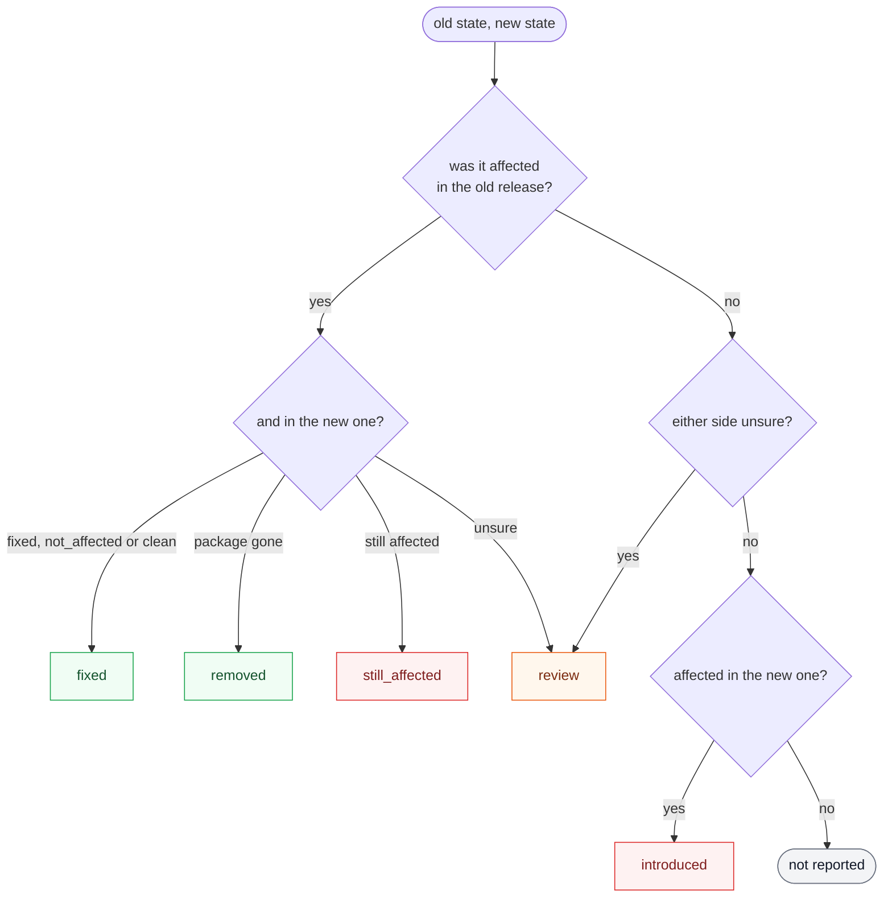

# diff

Compares the findings of two releases (`Compute`) and renders the "Security fixes" part
of the release notes (`FormatChangelog`). It is pure logic: the caller loads both SBOMs
and matches them against the same data. A wrong "fixed" line would be published as a
claim about the release, so whenever a side could not be fully checked, the pair goes to
`review` instead.

For each (vulnerability, package) pair, each side is reduced to one state: one of the four
VEX statuses, `absent` (package not shipped), `clean` (shipped, no finding) or `unchecked`
(could not be checked). `clean` is how a fix shows up for OSV.dev, which returns nothing
for unaffected versions. The pair of states then lands in a bucket:

"Unsure" means `under_investigation` or `unchecked`.

The JSON output (`Result`) has every bucket, plus `not_checked`: the packages no source
covers and whether OSV.dev was off. The changelog has only the `fixed` bucket, one
Markdown line per package with its CVEs, so check the JSON before trusting an empty
changelog. Go's `stdlib` and `toolchain` share one "Go" line, and a CVE is held back from
it while either of them is still affected or unchecked.
