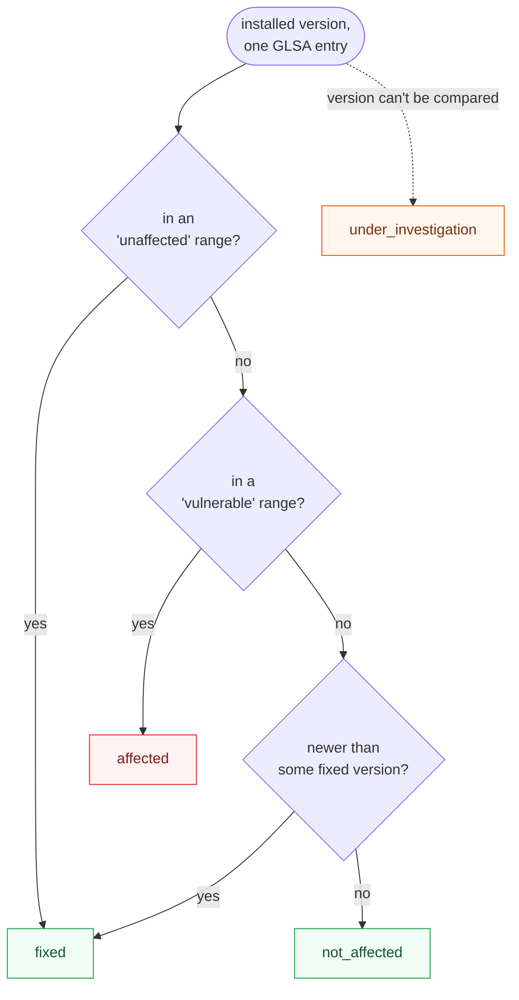

# source/glsa

Gentoo's advisories (GLSAs) as a vulnerability source for ebuild packages: keep a local
copy (`Sync`), read it (`LoadDir`) and check packages against it (`Match`).

## Sync

`Sync` clones Gentoo's GLSA repository into a directory, or updates an existing clone,
using go-git, so no `git` binary is needed for an https URL. It fetches only the latest
commit and makes the checkout match it exactly: edits are discarded and every file upstream
does not have is removed, untracked or not, so a withdrawn advisory can never linger and a
run that failed or was killed halfway is repaired by the next one. The result records the
exact upstream commit the advisories came from. It refuses to clone into a directory that
has other files in it, and refuses upstream paths git itself would reject (such as
anything under `.git`).
Credentials in a repository URL never appear in errors or progress output. A local
repository path still needs `git` installed, because go-git reads local repositories
through `git upload-pack`.

## Parsing

Each GLSA is an XML file naming CVEs and, per package, version ranges:

```xml
<package name="dev-libs/openssl" auto="yes" arch="*">
  <unaffected range="ge">3.0.13</unaffected>
  <vulnerable range="lt">3.0.13</vulnerable>
</package>
```

A file that can't be parsed, or that lacks an ID, a package or a range, is an error.
`LoadDir` still returns every GLSA it could read, together with a `ParseError` listing
the bad files, so the caller decides whether to continue.

## Matching

For every GLSA that applies to the architecture, and every installed package it names,
`Match` decides one status by asking the same questions in the same order as Gentoo's
`glsa-check`, which already gates Flatcar releases:



The third question exists because GLSAs often only say "fixed in 4.11.6 and later within
this branch". A much newer 4.22 is in neither range but clearly contains the fix.

Some ranges apply to one slot only, Gentoo's name for a parallel-installable branch such
as Python 3.11 versus 3.12. The SBOM does not record slots, so when the slot could change
the answer the result is `under_investigation`.

A few packages are versioned differently by Flatcar and Gentoo. Flatcar's
`ca-certificates` uses the NSS version (`3.125`), Gentoo's a date plus the NSS version
(`20260816.3.125`), so every Flatcar version would look older than every fix.
`versionscheme.go` translates such packages before comparing.

One GLSA lists several CVEs, so one match gives one finding per CVE. A GLSA naming no CVE
is reported under its own ID, `GLSA-<id>`.
