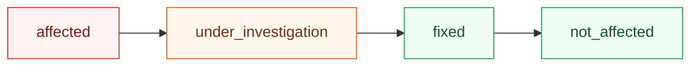

# vuln

The vocabulary every other package shares. A `Finding` says how one vulnerability (a CVE,
or a GLSA ID when the advisory names no CVE) affects one installed package, with a VEX
`Status`, the `Source` that said so and that source's advisory ID (`RefID`).

Sources produce findings and outputs consume them. Keeping the type here means `vexgen`
and `diff` never depend on how a source works, and a new source only has to produce
findings.

When findings for one vulnerability disagree, the most severe status wins
(`StatusPrecedence`), because a release cannot be both fixed and affected:

For example, if the image ships two copies of a Go module and only one is patched, the
CVE is `affected`. `Sort` puts findings in a fixed order so that the same input always
gives byte-identical output.
